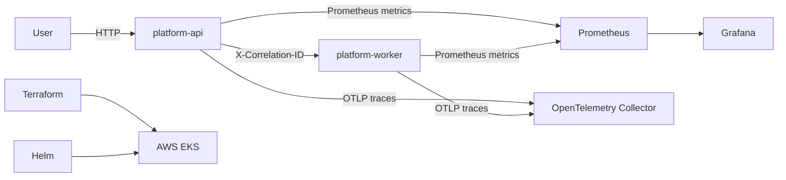

# Cloud-Native Java Developer Platform

This repository demonstrates a small, deployable Spring Boot platform for AWS EKS. It uses Java 21, Spring Boot 3.5, Maven, Kubernetes, Helm, Terraform, Prometheus, Grafana, OpenTelemetry, AWS Secrets Manager with External Secrets, and Chaos Mesh.

## Architecture



The API accepts validated job requests and forwards them to the worker. The worker creates a deterministic processing result and both services propagate a correlation ID.

## Local build

Requirements: Java 21, Maven 3.9+, Docker Desktop.

```powershell
cd cloud-native-java-platform
mvn clean verify
docker compose up --build
```

Endpoints:

- API status: http://localhost:8080/api/v1/status
- API health: http://localhost:8080/actuator/health
- API metrics: http://localhost:8080/actuator/prometheus
- Worker status: http://localhost:8081/api/v1/status
- Worker health: http://localhost:8081/actuator/health

Create a job:

```powershell
Invoke-RestMethod -Method Post `
  -Uri http://localhost:8080/api/v1/jobs `
  -ContentType application/json `
  -Headers @{ "X-Correlation-ID" = "demo-123" } `
  -Body '{"name":"build-image","retries":2}'
```

Stop local containers:

```powershell
docker compose down
```

## Helm deployment

```powershell
helm lint helm/platform
helm upgrade --install platform helm/platform `
  --namespace cloud-native-platform `
  --create-namespace `
  --set platformApi.tag=1.0.0 `
  --set platformWorker.tag=1.0.0
```

Validate:

```powershell
kubectl -n cloud-native-platform rollout status deployment/platform-api
kubectl -n cloud-native-platform rollout status deployment/platform-worker
kubectl -n cloud-native-platform get hpa,pod,poddisruptionbudget
```

## Terraform

This is a demonstration-scale setup in `us-east-1`. It creates a VPC, EKS cluster, and a small managed node group with Spot instances.

Create remote state resources:

```powershell
cd terraform/bootstrap
terraform init
terraform apply -var="state_bucket_name=CHANGE_ME-terraform-state"
```

Then replace placeholders in `terraform/environments/demo/main.tf`, initialize, and plan:

```powershell
cd ../environments/demo
terraform init
terraform plan -var="aws_region=us-east-1"
terraform apply
```

Configure Kubernetes:

```powershell
terraform output -raw configure_kubectl | Invoke-Expression
```

Destroy before finishing:

```powershell
terraform destroy
```

These resources incur AWS charges, including NAT gateway and EKS usage. Review costs and destroy the demo environment when not in use.

## Secrets and configuration

Spring Cloud Kubernetes is included for ConfigMap-based configuration. Kubernetes is disabled for local development and enabled through cluster configuration.

The Helm chart includes an External Secrets `SecretStore` placeholder for AWS Secrets Manager. Before production use:

1. Install External Secrets Operator.
2. Configure IRSA or workload identity for the platform service account.
3. Create a matching AWS Secrets Manager secret.
4. Replace or add `ExternalSecret` resources for non-demo values.
5. Never place credentials in `values.yaml`, ConfigMaps, Git, or container layers.

## Observability

- Spring Boot Actuator exposes health, info, and Prometheus metrics.
- Micrometer adds application and HTTP metrics.
- Micrometer tracing is configured for distributed trace propagation.
- `monitoring/prometheus.yml` provides Kubernetes Pod discovery.
- `monitoring/grafana/dashboard.json` is a starter dashboard.

For an external OpenTelemetry Collector, set the OTLP endpoint through the deployment environment and image instrumentation. No external collector endpoint is enabled by default.

## Chaos testing

Install Chaos Mesh into the cluster, limit experiments to `cloud-native-platform`, and apply:

```powershell
kubectl apply -f chaos/chaos-mesh.yaml
kubectl -n cloud-native-platform rollout status deployment/platform-api --timeout=120s
kubectl -n cloud-native-platform rollout status deployment/platform-worker --timeout=120s
kubectl -n cloud-native-platform get pods
```

Windows script alternative:

```powershell
.\chaos\run-chaos-test.ps1 apply
.\chaos\run-chaos-test.ps1 verify
.\chaos\run-chaos-test.ps1 cleanup
```

The PodChaos experiment removes one API pod for 30 seconds. The NetworkChaos experiment adds 250 ms delay for 20 seconds. Remove experiments immediately if recovery is not expected.

## CI/CD

GitHub Actions builds and tests Maven, lints Helm, renders manifests, and checks Terraform formatting. Pull-request builds do not require AWS credentials.

AWS deployment credentials are intentionally placeholders. To enable deployment:

1. Create an isolated AWS demo account or least-privilege IAM role.
2. Configure GitHub Actions OIDC or repository secrets.
3. Add a protected `aws-demo` environment.
4. Require manual review before applying AWS or Kubernetes changes.
5. Replace the placeholder publish job with explicit ECR, EKS, and Helm steps.

## Validation

```powershell
mvn test
mvn verify
docker compose config
helm lint helm/platform
terraform -chdir=terraform/environments/demo fmt -check
terraform -chdir=terraform/environments/demo validate
```

## Security and operating notes

- Containers run as non-root with a read-only root filesystem.
- Kubernetes SecurityContexts disable privilege escalation and Linux capabilities.
- HPA and PodDisruptionBudget settings protect service capacity.
- Deployment uses rolling updates with no unavailable API replicas.
- All AWS and registry credentials must come from an external identity mechanism.
- Chaos experiments must run only in the dedicated namespace.
- Use application logs and X-Correlation-ID values to correlate API and worker requests.
